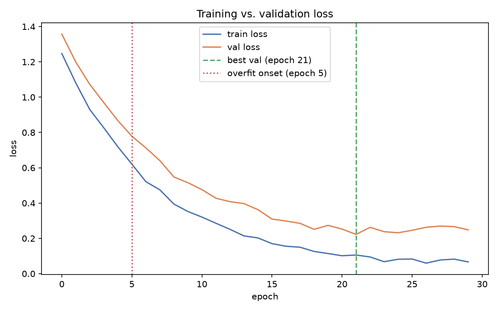

# Early Stopping & Overfitting Monitor

A lightweight, dependency-free Python utility for **early stopping** and **training diagnostics**. It watches your validation loss, stops training when progress stalls, restores the best model state, and plots train/validation curves with best-epoch and overfitting-onset markers.

Works with any framework (PyTorch, TensorFlow, JAX, scikit-learn, or plain Python) because it only needs the loss values and two optional callbacks for saving and restoring state.



*Output of `demo.py`: training stopped at epoch 29, and the best validation loss was recorded at epoch 21 (green dashed line).*

---

## Features

- **Patience-based early stopping** for both `min` and `max` metrics
- **Dual improvement threshold**: absolute (`min_delta`) and relative (`min_delta_rel`), whichever is larger
- **Warm-up period** during which no improvement or patience counting takes place
- **Best-state restoration** through user-supplied `state_getter` / `state_setter` callbacks
- **Overfitting onset detection** based on the smoothed generalization gap (validation minus training loss)
- **Built-in plotting** with matplotlib (optional dependency)
- **JSON export** of the full training history
- **No required dependencies**, standard library only

## Repository Structure

| File | Description |
|------|-------------|
| `early_stopping.py` | Core library: `EarlyStopping`, `TrainingMonitor`, `EarlyStoppingTrainer` |
| `demo.py` | Runnable demo using synthetic loss curves that begin to overfit |
| `loss_curves.png` | Example plot generated by the demo |

## Installation

No package installation is required. Copy `early_stopping.py` into your project.

```bash
git clone https://github.com/<your-username>/<your-repo>.git
cd <your-repo>

# Optional: only needed for plotting
pip install matplotlib
```

**Requirements:** Python 3.7+ (matplotlib is optional and used only by `plot()`).

## Quick Start

Run the bundled demo:

```bash
python demo.py
```

This simulates 60 epochs of training with overfitting that begins around epoch 18, stops early, restores the best state, prints a summary, and saves `loss_curves.png`.

### Using it in your own training loop

```python
from early_stopping import EarlyStoppingTrainer

trainer = EarlyStoppingTrainer(
    patience=8,
    min_delta=1e-4,
    min_delta_rel=1e-3,
    mode="min",
    warmup_epochs=3,
    restore_best=True,
    state_getter=lambda: copy.deepcopy(model.state_dict()),
    state_setter=lambda state: model.load_state_dict(state),
)

for epoch in range(max_epochs):
    train_loss = train_one_epoch(model)
    val_loss = evaluate(model)

    if trainer.step(epoch, train_loss, val_loss):
        print("Early stopping triggered.")
        break

trainer.restore_best_weights()
print(trainer.summary())
trainer.plot(path="loss_curves.png")
```

> **Tip:** `state_getter` should return a *copy* of your model state (for example `copy.deepcopy(model.state_dict())`). Otherwise the stored "best" state will be overwritten as training continues.

## How It Works

### Improvement rule

An epoch counts as an improvement when the metric beats the current best by more than a threshold:

```
threshold = max(min_delta, min_delta_rel * |best_score|)

mode="min":  current < best_score - threshold
mode="max":  current > best_score + threshold
```

Each epoch without improvement increments a counter. When it reaches `patience`, `should_stop` becomes `True`.

### Warm-up

Epochs with `epoch < warmup_epochs` are recorded in the history but are ignored for best-score tracking and patience counting. The first epoch after warm-up is always accepted as the initial best.

### Overfitting onset detection

`TrainingMonitor` computes the generalization gap (`val_loss - train_loss`) each epoch and smooths it with a moving average (`gap_smoothing`). Once enough points have been collected, it tracks the minimum smoothed gap. If the gap stays above that minimum (by more than `gap_min_delta`) for `gap_patience` consecutive epochs, the epoch of the minimum gap is reported as the overfitting onset.

This is a **heuristic diagnostic**. It does not influence the stopping decision, which is driven entirely by `EarlyStopping` on validation loss. See [Limitations](#limitations).

## API Reference

### `EarlyStoppingTrainer`

The convenience wrapper that combines `EarlyStopping` and `TrainingMonitor`.

| Parameter | Default | Description |
|-----------|---------|-------------|
| `patience` | `10` | Epochs without improvement before stopping |
| `min_delta` | `0.0` | Minimum absolute improvement |
| `min_delta_rel` | `1e-4` | Minimum relative improvement (fraction of best score) |
| `mode` | `"min"` | `"min"` or `"max"` |
| `warmup_epochs` | `0` | Initial epochs excluded from improvement tracking |
| `restore_best` | `True` | Save and restore the best state |
| `state_getter` | `None` | Callable returning the current model state |
| `state_setter` | `None` | Callable that loads a saved state |
| `gap_smoothing` | `3` | Moving-average window for the generalization gap |
| `gap_patience` | `5` | Consecutive rising-gap epochs needed to flag overfitting |
| `verbose` | `True` | Print progress messages |

| Method | Description |
|--------|-------------|
| `step(epoch, train_loss, val_loss, **extra)` | Log an epoch. Returns `True` if training should stop |
| `restore_best_weights()` | Restore the best saved state. Returns `True` if a state was restored |
| `plot(path=None, show=False)` | Plot train/val loss with best-epoch and overfit-onset markers |
| `summary()` | Human-readable summary string |

### `EarlyStopping`

The standalone stopper, available as `trainer.stopper`. Call `step(current_score, epoch=None)`; also provides `restore_best_weights()`, `reset()`, and `summary()`. Useful attributes: `best_score`, `best_epoch`, `num_bad_epochs`, `should_stop`, `history`.

### `TrainingMonitor`

The standalone curve tracker, available as `trainer.monitor`.

| Member | Description |
|--------|-------------|
| `log(epoch, train_loss, val_loss, **extra)` | Record an epoch |
| `overfitting_onset_epoch` | Detected onset epoch, or `None` |
| `best_val_epoch()` | Epoch with the lowest validation loss |
| `generalization_gap(epoch_idx=-1)` | `val_loss - train_loss` at a given index |
| `to_dict()` / `save_json(path)` | Export history as a dict or JSON file |
| `plot(path=None, show=False)` | Render the loss curves |

### Using the stopper on its own

```python
from early_stopping import EarlyStopping

stopper = EarlyStopping(patience=5, mode="max")  # e.g. monitoring accuracy

for epoch in range(100):
    acc = validate()
    if stopper.step(acc, epoch=epoch):
        break
```

## Limitations

- The overfitting-onset detector watches the *gap* between validation and training loss. A gap that widens naturally early in training (as in the example plot, where onset is flagged at epoch 5) can be flagged before true overfitting begins. Treat it as a diagnostic, and compare it with the best-validation epoch.
- `EarlyStoppingTrainer` always monitors **validation loss**. To monitor another metric, use `EarlyStopping` directly.
- State capture relies on your callbacks; the library does not serialize models to disk.

## Contributing

Issues and pull requests are welcome. Please open an issue to discuss significant changes first.

## License

Add your license here (for example, MIT) and include a `LICENSE` file in the repository.
